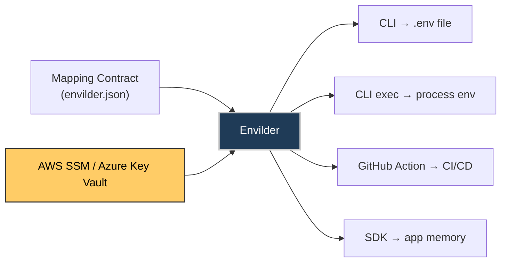

# 🗝️ Envilder ☁️

<p align="center">
  
</p>

<p align="center">
  <b>One secret mapping for local dev, CI/CD, and runtime.</b><br>
  <span>Define secrets once in <code>envilder.json</code>. Resolve them consistently from AWS SSM or Azure Key Vault.</span><br>
  <a href="https://envilder.com/?utm_source=github&utm_medium=readme&utm_campaign=root"><strong>Website & docs → envilder.com</strong></a>
</p>

[](https://www.npmjs.com/package/envilder)
[](https://npmcharts.com/compare/envilder)
[](https://github.com/macalbert/envilder/actions/workflows/tests.yml)
[](https://macalbert.github.io/envilder/)
[](https://www.bestpractices.dev/projects/15703)
[](https://snyk.io/test/github/macalbert/envilder)
[](./LICENSE)
[](https://context7.com/macalbert/envilder)
[](https://coderabbit.ai)

## Why Envilder?

Your new developer joins the team. They need environment variables to run the app locally.
What happens next? Someone sends API keys over Slack. Someone else digs up a wiki page
with outdated credentials. Forty-five minutes later, their `.env` file is "probably correct".

**Envilder fixes this with one versioned mapping contract.**

You create a JSON mapping between variable names and cloud secret paths. Envilder resolves
them from AWS SSM or Azure Key Vault. The same mapping file works in local dev (CLI),
CI/CD (GitHub Action), and application startup (runtime SDKs).

```bash
# Push a secret: it is stored in your cloud and mapped in envilder.json
npx envilder --key=API_KEY --value=s3cret --secret-path=/my-app/api-key

# Zero-config: uses envilder.json and .env by default
npx envilder

# Or with explicit paths
npx envilder --map=envilder.json --envfile=.env

# Or skip the file: run your app with the secrets in memory
npx envilder exec -- npm run dev
```

No SaaS middleman. One versioned mapping contract. Secrets stay in your cloud.

## The problem

- **Onboarding takes hours, not seconds.** Every new developer needs someone to explain which
  secrets go where. Keys get shared over Slack, pasted from wikis, or copied from a colleague's
  machine. It's slow, error-prone, and insecure.
- **Every environment has its own workflow.** Local dev reads `.env` files. CI/CD uses vault
  integrations. Production has its own method. Same app, three different secret workflows.
- **No single mapping contract.** Your cloud provider may be the source of truth for secret
  values, but each environment still needs to know how application variables map to those
  secrets. Without a versioned contract, dev, staging, and production configurations drift apart.
- **The `.env` file is readable by everything in your repo.** `.gitignore` keeps it out of commits,
  not out of reach. Editors, indexers, install scripts, and AI coding agents can all read the
  plaintext values sitting in your working tree.

## How Envilder solves it

- 📋 **One mapping contract for everything.** A single `envilder.json` defines what secrets your app
  needs and where they live. Git-versioned, PR-reviewable, and reused across environments.
- ⚡ **Works everywhere your code runs.** CLI for local dev, GitHub Action for CI/CD, runtime SDKs
  for application startup. Same file, same result.
- 🚫 **No `.env` file when you don't want one.** `envilder exec` starts any command with the
  secrets in its environment, in any language, without writing anything to disk.
- 🔄 **Rotate secrets without config drift.** Keep application-facing variable names stable while
  rotating real secret values in AWS SSM or Azure Key Vault. Generated `.env` files update only
  when Envilder runs again; runtime consumers must restart or resolve again.
- 🛡️ **Your cloud, zero infrastructure.** Secrets stay in AWS SSM or Azure Key Vault. No SaaS
  proxy or extra servers. The mapping contract stays consistent, while provider credentials and
  secret migration remain provider-specific.

## ⚙️ Features

| Feature | Description |
|---------|-------------|
| 📋 **Declarative Mapping** | One JSON file defines how application variables map to cloud secrets. Git-versioned, PR-reviewable, and diff-able |
| ☁️ **Cloud-native Providers** | AWS SSM and Azure Key Vault today |
| ⚡ **Exec Mode** | `envilder exec -- <command>` runs any command with the secrets in its environment. Nothing written to disk, fail-closed, exit codes propagated. [Guide](docs/exec-command.md) |
| 🔌 **Runtime SDKs** | Load secrets into memory at app startup: [.NET](./src/sdks/dotnet/README.md), [Python](./src/sdks/python/README.md), [Node.js](./src/sdks/nodejs/README.md). No `.env` on disk |
| ⚙️ **GitHub Action** | Pull secrets in CI/CD. Same mapping, zero manual config |
| 🔄 **Pull & Controlled Push** | Pull secrets to `.env`, or intentionally push local values to your cloud provider when bootstrapping or rotating |
| 🧱 **Zero Infrastructure** | No servers, no proxies, no SaaS. Uses cloud services you already have |

## 🚀 Quick Start

### 1. Run with npx

```bash
npx envilder --version
```

Or install globally:

```bash
npm install -g envilder
```

> **Requirements:** Node.js v22.12+. Configure credentials for either AWS SSM or Azure Key Vault,
> with read access, plus write access to push secrets.
> See [full requirements](docs/requirements-installation.md).

### 2. Map your secrets (`envilder.json`)

Push a secret and Envilder writes the mapping for you:

```bash
npx envilder --key=API_KEY --value=s3cret --secret-path=/my-app/api-key
# ✓ Created envilder.json

npx envilder --key=DB_PASSWORD --value=pa55word --secret-path=/my-app/db/password
# ✓ Added DB_PASSWORD to envilder.json
```

The secrets are stored in AWS SSM, and `envilder.json` now maps each variable to its secret path:

```json
{
  "API_KEY": "/my-app/api-key",
  "DB_PASSWORD": "/my-app/db/password"
}
```

The values are never written to the file, so it is safe to commit and review in PRs. If your secrets already exist
in the cloud, write the same file by hand instead. Use `--map=<file>` to write a different file, or
`--no-map-update` to push without touching any map file.
See the [Push Command Guide](docs/push-command.md#single-variable-push) for the details.

> 💡 Using Azure Key Vault? Add `--provider=azure --vault-url=https://my-vault.vault.azure.net` to the first push
> and Envilder writes the matching `$config`. See [Mapping File Format](#️-mapping-file-format) below.

### 3. Run your app with the secrets

```bash
npx envilder exec -- npm run dev
```

`envilder exec` resolves the mapping and starts your command with the secrets in its environment.
Nothing is written to disk. Envilder options go before the command (or before an optional `--`); everything
after belongs to your command. Exec mode is fail-closed: the command does not start if any secret is missing.
It is not a sandbox: your command and everything it starts can read the secrets.

📖 See the [Exec Command Guide](docs/exec-command.md) for exit codes, signals and GitHub Actions masking.

### 4. Need a `.env` file? Pull it

```bash
npx envilder
```

With `envilder.json` in your current directory, no flags are needed — `--map` defaults to `envilder.json` and
`--envfile` defaults to `.env`. Your secrets are pulled from AWS SSM and written to `.env`.
Add `.env` to `.gitignore` and treat it as a secret.

💡 Runnable examples: [envilder-examples](https://github.com/macalbert/envilder-examples) (Testcontainers and Aspire for
.NET, Python and TypeScript, AWS SSM and Azure Key Vault, plus `envilder exec`).

### 🎥 See it in action

Watch how easy it is to automate your `.env` management in less than 1 minute:


## 🗺️ Mapping File Format

The mapping file (`envilder.json`) is the core of Envilder. It's the single model that defines
what secrets your app needs and where they live in your cloud provider. The same file is used by
the CLI, the GitHub Action, and the runtime SDKs. You can optionally include a `$config` section
to declare which provider and settings to use.

Editors that use [SchemaStore](https://www.schemastore.org/) (VS Code, JetBrains IDEs) give you autocomplete,
inline documentation and validation for `envilder.json` and `envilder.*.json` files automatically.
For any other file name, add `"$schema": "https://envilder.com/schema/map-file.v1.json"`; a single-secret push
adds it for you when the file name needs it. The schema is published at
[envilder.com/schema/map-file.v1.json](https://envilder.com/schema/map-file.v1.json).

### Basic Format (AWS SSM, default)

When no `$config` is present, Envilder defaults to AWS SSM Parameter Store:

```json
{
  "API_KEY": "/myapp/prod/api-key",
  "DB_PASSWORD": "/myapp/prod/db-password",
  "SECRET_TOKEN": "/myapp/prod/secret-token"
}
```

Values are SSM parameter paths (e.g., `/myapp/prod/api-key`).

### With `$config` (explicit provider)

Add a `$config` key to declare the provider and its settings. Envilder reads `$config` for configuration
and uses all other keys as secret mappings:

#### AWS SSM with profile

```json
{
  "$config": {
    "provider": "aws",
    "profile": "prod-account"
  },
  "API_KEY": "/myapp/prod/api-key",
  "DB_PASSWORD": "/myapp/prod/db-password"
}
```

#### Azure Key Vault

```json
{
  "$config": {
    "provider": "azure",
    "vaultUrl": "https://my-vault.vault.azure.net"
  },
  "API_KEY": "myapp-prod-api-key",
  "DB_PASSWORD": "myapp-prod-db-password"
}
```

**Secret names.** Key Vault secret names only allow alphanumeric characters and hyphens. The only
translation is for paths: slashes become hyphens and a leading slash is dropped (e.g.,
`/myapp/db/password` → `myapp-db-password`). Anything else is sent as written, so a name Key Vault
rejects (for example one with `_` or `.`) fails with Key Vault's own error. The CLI, the GitHub
Action and every SDK apply the same rule, so they all read the same secret.

**Name collisions.** The CLI and the GitHub Action also reject a map file in which two values
resolve to the same name, ignoring case (`/app/db-url` and `app-db-url`), so a push cannot write
both to one secret. The SDKs only read secrets, so they skip that check.

### `$config` Options

| Key | Type | Default | Description |
| --- | --- | --- | --- |
| `provider` | `"aws"` \| `"azure"` | `"aws"` | Cloud provider to use |
| `vaultUrl` | `string` | - | Azure Key Vault URL (required when `provider` is `"azure"`) |
| `profile` | `string` | - | AWS CLI profile for multi-account setups (AWS only) |

### Configuration Priority

CLI flags and GitHub Action inputs always override `$config` values:

```txt
CLI flags / GHA inputs  >  $config in map file  >  defaults (AWS)
```

This means you can set a default provider in `$config` and override it per invocation:

```bash
# Uses $config from the map file
envilder

# Overrides provider and vault URL from the map file
envilder --provider=azure --vault-url=https://other-vault.vault.azure.net --map=envilder.json --envfile=.env
```

### Keys and Values: What Is Accepted

Every mapping has the shape `"<KEY>": "<secret reference>"`. The key-name rule below is the same
in the CLI, the GitHub Action, the [JSON Schema](https://envilder.com/schema/map-file.v1.json) and
every runtime SDK, so a key accepted in one place is accepted everywhere
([ADR-0008](docs/adr/0008-map-file-schema.md)). The schema is stricter in two other ways: it also
flags non-string values and unknown `$`-prefixed keys, which the runtime parsers skip.

#### Keys (environment variable names)

| Rule | Details |
| --- | --- |
| Allowed characters | Letters `A-Z` `a-z`, digits `0-9`, `_`, `.`, `-` and `/` (`^[A-Za-z0-9_./-]+$`) |
| Recommended | `^[A-Za-z_][A-Za-z0-9_]*$`: a POSIX name, usable from any shell |
| Rejected | An empty name, any other character (space, tab, `#`, `=`, `:`, line breaks, `U+2028`/`U+2029`, accented or non-Latin letters) and the name `__proto__` |
| Reserved | Keys starting with `$` (`$schema`, `$config`) are metadata, never variables |
| Non-string values | A mapping whose value is not a string is skipped, but its key is still validated |

A map file with an invalid key is rejected as a whole, before any secret is fetched. The error
quotes the key and never the value.

**Why this exact set?** A key must reach your application as itself and nothing else. Any other
character either opens a different assignment in a `.env` file (`=`, line breaks,
`U+2028`/`U+2029`: the injection fixed in [#511](https://github.com/macalbert/envilder/issues/511))
or produces a line that every reader silently drops. `__proto__` is inside the character set but
is dropped by every JavaScript reader that builds a plain object, `dotenv` included.

#### Hierarchical keys with `/`

`/` is accepted everywhere, so a key like `Database/Password` keeps working in every mode:

| Where | What your application gets |
| --- | --- |
| Runtime SDKs (`resolve`, `load`) | The name as-is: `Database/Password` |
| .NET SDK `IConfiguration` | The section `Database:Password`, as with AWS's own SSM configuration provider |
| `envilder exec` | The name as-is in the child process environment |
| `.env` file (CLI, GitHub Action) | The line `Database/Password=...`, written as-is, plus a warning |

The warning is there because `.env` readers disagree about `/`:

| Consumer reading `Database/Password=secret` | Result |
| --- | --- |
| `python-dotenv` | Loaded |
| `dotenv` (Node.js) | Line ignored: the variable never loads |
| Docker Compose `env_file` | Error: `unexpected character "/" in variable name` |
| `set -a; source .env` (bash) | Error: the variable does not exist |

If your application reads the `.env` file with one of the last three, use `envilder exec`, or
name the key with `__` (`Database__Password`), which every reader loads and .NET's
environment-variables provider maps to the same `Database:Password` section.

#### Values (secret references)

A value is the identifier of the secret in the provider. It must be a JSON string.

| Provider | Identifier format |
| --- | --- |
| AWS SSM | Parameter name, used as-is. Case-sensitive; `a-zA-Z0-9_.-` plus `/` for hierarchies (at most 15 levels); up to 1011 characters including the ARN prefix; cannot start with `aws` or `ssm` ([AWS constraints](https://docs.aws.amazon.com/systems-manager/latest/userguide/what-is-a-parameter.html#sysman-parameter-name-constraints)) |
| Azure Key Vault | Secret name: 1-127 characters, letters, digits and `-` ([Azure naming](https://learn.microsoft.com/azure/key-vault/general/about-keys-secrets-certificates#objects-identifiers-and-versioning)). Slashes become hyphens and a leading slash is dropped (`/myapp/db/password` → `myapp-db-password`); anything else is sent as written, the same in the CLI, the GitHub Action and every SDK (see [Azure Key Vault](#azure-key-vault)) |

#### Secret contents (the resolved values)

Envilder never rewrites a secret value: what the provider returns is what your application gets.
The limits come from where the value is stored:

| Stage | Limit |
| --- | --- |
| Provider | AWS SSM: 4 KB (standard) or 8 KB (advanced tier). Azure Key Vault: 25 KB |
| `.env` file (CLI, GitHub Action) | See below |
| Process environment (SDK `load` / `inject`, or any tool that loads the `.env`) | The operating system cannot store `NUL` (`U+0000`) in a variable, and Windows limits a variable to 32,767 characters |

The SDKs' resolve-only APIs (`resolve`, `ResolveFile`, `IConfiguration`) return values in memory
and are subject to the provider limits only.

**How the CLI writes `.env` values.** Each value is written so that `dotenv` reads back exactly
the original string. The quoting is chosen automatically and checked by parsing the result before
the file is written. The check uses dotenv's grammar extended to keys with `/`, so for those keys it
proves the value round-trips, not that Node.js `dotenv` loads them (it skips such lines, as shown
above):

| Value | Written as |
| --- | --- |
| `plain`, `she said "hi"` | `KEY=plain`, `KEY=she said "hi"` (no quotes needed) |
| `alpha#beta` | `KEY='alpha#beta'` (unquoted, `#` would start a comment) |
| `padded` with two leading and trailing spaces | `KEY='  padded  '` (unquoted, the spaces would be trimmed) |
| `first` + line break + `second` | `KEY="first\nsecond"` (read back as a real line break) |

`#`, leading and trailing whitespace, quotes, backslashes, a literal `\n`, real LF/CRLF line
breaks and Unicode all round-trip. When the file already exists, each assignment is replaced in
place (a multiline one entirely), and comments, ordering and line endings are preserved.

One combination cannot be expressed by any `.env` quoting: a value containing all three quote
characters (`'`, `"` and `` ` ``) together with a line break, leading or trailing whitespace, or
a `#`. The CLI then stops with an error that names the variable, and the `.env` file is left
unchanged. Store such a value encoded (for example base64) or read it with an SDK instead.

> **Variable expansion:** Envilder writes `${...}` literally and `dotenv` does not expand it,
> but other loaders do. Docker Compose, for instance, expands an unquoted `KEY=${HOME}` when it
> reads the file. Keep this in mind when a secret contains `$`.

## 🧩 Runtime SDKs

Beyond the CLI and GitHub Action, Envilder provides **runtime SDKs** that resolve secrets
directly into your application's memory at startup. No `.env` file written to disk, no secrets
left behind. SDKs use the same map-file format as the CLI.

### .NET SDK

Install via NuGet:

```bash
dotnet add package Envilder
```

Load secrets into `IConfiguration` or inject them into the process environment:

```csharp
// Option A: integrate with IConfiguration
var config = new ConfigurationBuilder()
    .AddEnvilder("envilder.json")
    .Build();

var dbPassword = config["DB_PASSWORD"];

// Option B: resolve + inject into environment
Env.Load("envilder.json");
var dbPassword = Environment.GetEnvironmentVariable("DB_PASSWORD");
```

📖 **[Full .NET SDK docs](./src/sdks/dotnet/README.md)** · 💡 **Examples:** [Testcontainers](https://github.com/macalbert/envilder-examples/tree/main/dotnet-testcontainers) · [Aspire](https://github.com/macalbert/envilder-examples/tree/main/dotnet-aspire)

### Python SDK

Install via uv (recommended) or pip:

```bash
uv add envilder
# or
pip install envilder
```

Load secrets into your application with a single line:

```python
from envilder import Envilder

# Resolve + inject into os.environ
Envilder.load('envilder.json')
```

Or route by environment, where each environment points to its own map file:

```python
from envilder import Envilder

Envilder.load('production', {
    'production': 'prod-secrets.json',
    'development': 'dev-secrets.json',
    'test': None,  # no secrets loaded
})
```

📖 **[Full Python SDK docs](./src/sdks/python/README.md)** · 💡 **Examples:** [Testcontainers](https://github.com/macalbert/envilder-examples/tree/main/python-testcontainers)

### Node.js SDK

Install via npm:

```bash
npm install @envilder/sdk
```

Load secrets into your application with a single line:

```typescript
import { Envilder } from '@envilder/sdk';

// Resolve + inject into process.env
const secrets = await Envilder.load('envilder.json');
```

Or use the fluent builder for full control:

```typescript
import { Envilder, SecretProviderType } from '@envilder/sdk';

const secrets = await Envilder.fromMapFile('envilder.json')
  .withProvider(SecretProviderType.Aws)
  .withProfile('prod-account')
  .resolve();
```

📖 **[Full Node.js SDK docs](./src/sdks/nodejs/README.md)** · 💡 **Examples:** [Testcontainers](https://github.com/macalbert/envilder-examples/tree/main/typescript-testcontainers) · [Aspire](https://github.com/macalbert/envilder-examples/tree/main/typescript-aspire)

## 🤖 GitHub Action

Reference the published `macalbert/envilder/github-action@v0` tag directly. It contains the
prebuilt action, so consumers do not need an Envilder build step.

**AWS SSM (default):**

```yaml
- name: Configure AWS Credentials
  uses: aws-actions/configure-aws-credentials@v5
  with:
    role-to-assume: ${{ secrets.AWS_ROLE_TO_ASSUME }}
    aws-region: us-east-1

- name: Pull secrets from AWS SSM
  uses: macalbert/envilder/github-action@v0
  with:
    map-file: envilder.json
    env-file: .env
```

**Azure Key Vault:**

```yaml
- name: Azure Login
  uses: azure/login@v2
  with:
    client-id: ${{ secrets.AZURE_CLIENT_ID }}
    tenant-id: ${{ secrets.AZURE_TENANT_ID }}
    subscription-id: ${{ secrets.AZURE_SUBSCRIPTION_ID }}

- name: Pull secrets from Azure Key Vault
  uses: macalbert/envilder/github-action@v0
  with:
    map-file: envilder.json
    env-file: .env
    provider: azure
    vault-url: ${{ secrets.AZURE_KEY_VAULT_URL }}
```

📖 **[Full GitHub Action docs](./github-action/README.md)**

### 📚 More resources

- [📖 Full Documentation](https://envilder.com/docs/getting-started/?utm_source=github&utm_medium=readme&utm_campaign=root-docs): the complete guide at envilder.com
- [Push Command Guide](docs/push-command.md)
- [Pull Command Guide](docs/pull-command.md)
- [Exec Command Guide](docs/exec-command.md)
- [envilder-examples](https://github.com/macalbert/envilder-examples): runnable examples for the SDKs and `envilder exec`
  (Testcontainers and Aspire, AWS SSM and Azure Key Vault)
- [🤖 Envilder on Context7](https://context7.com/macalbert/envilder): up-to-date docs for AI coding assistants
  (Claude Code, Cursor, Copilot). Add `use context7` to your prompt, or reference the library ID `/macalbert/envilder`.

## 🛠️ How it works



1. **Define**: create an `envilder.json` mapping env var names to cloud secret paths
2. **Resolve**: Envilder fetches each secret from your cloud vault
3. **Deliver**: secrets arrive as a `.env` file (CLI/GHA), in the environment of a command you
   start with `envilder exec` (CLI), or in-memory (SDKs)
4. **Rotate**: update secret values in your cloud provider while keeping the same
   application-facing mapping. Rerun Envilder to refresh a generated `.env`, or restart/re-resolve
   in runtime consumers
5. **Bootstrap**: optionally push local values to your cloud provider when intentionally
   setting up or rotating secrets

## What Envilder is not

Envilder is not a secrets manager. It does not replace Vault, Infisical, or Doppler.

It also does not replace AWS SSM or Azure Key Vault: it works on top of them. Envilder does not
store secrets, proxy requests, or introduce a SaaS control plane.

Your cloud provider remains the source of truth. Envilder provides the mapping and resolution
layer that makes those secrets usable consistently across local development, CI/CD, and runtime.

Use Envilder when your secrets already live in your cloud provider and you want one versioned
`envilder.json` mapping contract everywhere your code runs.

`envilder exec` is not a sandbox either. It keeps secrets off the disk, but it does not isolate
the process: your command and every process it starts can read them. It also leaves an existing
`.env` file untouched, so delete it yourself when you move from pull mode to exec mode.

## 🏁 What's Next

Envilder already covers CLI (including `envilder exec`), GitHub Action, and runtime SDKs for .NET, Python, and Node.js.

Next priorities include Go and Java SDKs and GCP Secret Manager.

See the [full roadmap](./ROADMAP.md).

## 🤝 Contributing

All contributions are welcome: PRs, issues, docs, examples, and feedback from real usage.

Good first contributions include trying Envilder with an existing AWS SSM or Azure Key Vault
setup, improving examples, testing the GitHub Action, or reviewing SDK ergonomics.

See [CONTRIBUTING.md](./CONTRIBUTING.md).

## 💜 Sponsors

<p align="center">
  <a href="https://localstack.cloud" target="_blank" rel="noopener noreferrer">
    <picture>
      <source media="(prefers-color-scheme: dark)" srcset="./src/website/public/localstack-logo-horizontal-Light.svg">
      <source media="(prefers-color-scheme: light)" srcset="./src/website/public/localstack-logo-horizontal-Dark.svg">
      
    </picture>
  </a>
  &nbsp;&nbsp;&nbsp;
  <a href="https://snyk.io/open-source/" target="_blank" rel="noopener noreferrer">
    <picture>
      <source media="(prefers-color-scheme: dark)" srcset="./src/website/public/snyk-logo-Light.svg">
      <source media="(prefers-color-scheme: light)" srcset="./src/website/public/snyk-logo-Dark.svg">
      
    </picture>
  </a>
</p>

<p align="center">
  Envilder is also supported through the
  <a href="https://aws.amazon.com/blogs/opensource/aws-cloud-credits-for-open-source-projects-affirming-our-commitment/">AWS Open Source Credits Program</a>.
</p>

## 📜 License

MIT © [Marçal Albert](https://github.com/macalbert)  
See [LICENSE](./LICENSE) | [CHANGELOG](./docs/CHANGELOG.md) | [Security Policy](./docs/SECURITY.md)
