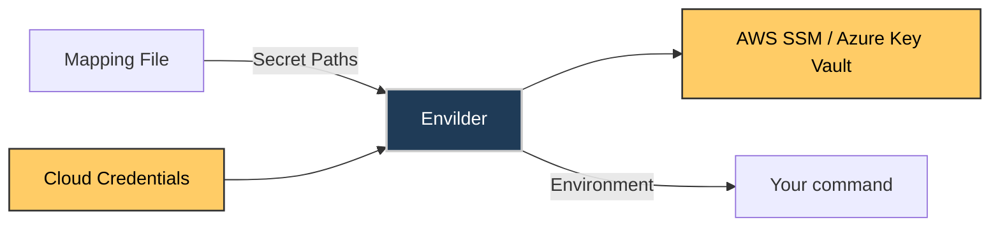

# Envilder: Exec Command

## Overview

`envilder exec` resolves every secret declared in the map file and starts a
command with those values in its environment, **without writing anything to
disk**.

```bash
envilder exec -- npm run dev
envilder exec --map=config/envilder.json -- node server.js
envilder exec --provider=azure --vault-url=https://my-vault.vault.azure.net -- dotnet run
```

The map file stays in Git and the values stay in your cloud provider. The only
difference with pull mode is where the values end up:

```text
pull mode:  provider -> .env on disk -> process
exec mode:  provider -> memory -> child process environment
```

There is no `.env` file to gitignore, keep in sync or clean up, and nothing in
the working tree for editors, indexers, build tools or install scripts to read.



## Usage

```text
envilder exec [options] [--] <command> [args...]
```

| Option | Description |
| ------ | ----------- |
| `--map <path>` | Path to the map file. Defaults to `envilder.json` in the current directory. |
| `--profile <name>` | AWS CLI profile. Overrides `$config.profile`. |
| `--provider <name>` | `aws` or `azure`. Overrides `$config.provider`. |
| `--vault-url <url>` | Azure Key Vault URL. Overrides `$config.vaultUrl`. |

The map file and its `$config` section work exactly as in pull mode. See
[Mapping File Format](../README.md#️-mapping-file-format).

### Where the command starts: the `--` rule

Envilder options come first. The command starts at the **first argument that
is not an Envilder option**, or right after `--` when present. Everything from
there on is passed to the command verbatim, even if it looks like an Envilder
option.

```bash
envilder exec npm run dev                       # everything belongs to npm
envilder exec --map=cfg.json npm run dev        # --map is Envilder's, the rest is npm's
envilder exec npm run dev --map=x               # --map=x belongs to npm (it comes after the command)
envilder exec --map=cfg.json -- npm run dev     # same, with an explicit separator
envilder exec -- -weird-program-name            # use -- when the command itself starts with -
```

An unknown option before the command is an error (exit code `125`), so a typo
such as `--mapp` never reaches your command by accident. Error messages never
repeat what you typed beyond a safe option name: an unknown option is named
only when it is a near-typo of a real option, with a suggestion, and gets a
generic message otherwise. Options such as `--map` or `--profile` never take a
value that starts with `-`: `envilder exec --map --profile dev node` is
reported as `error: option '--map <path>' argument missing` instead of
treating `--profile` as the map path.

Envilder options also go **after** `exec`, never before it. An option written
before `exec` is rejected with exit code `125` instead of being silently
ignored, and Envilder shows the corrected command:

```text
$ envilder --map=config/prod.json exec -- npm start
error: Put envilder options after "exec": envilder exec --map=config/prod.json -- npm …
```

The suggestion shows your command by program name only, followed by `…` when
it has arguments: arguments can carry secrets (for example an
`Authorization` header), so Envilder never prints them.

Only the options exec supports (`--map`, `--profile`, `--provider`,
`--vault-url`) are moved into the suggested command. Options exec does not
support (`--envfile`, `--push`, `--key`, `--value`, `--secret-path`,
`--ssm-path`) are named but **their values are never printed**, because a
value such as `--value` can be a secret:

```text
$ envilder --value=s3cret exec -- node app.js
error: Put envilder options after "exec".
--value cannot be used with exec.
```

### Options that are rejected

Exec mode never reads or writes a `.env` file and never pushes secrets. These
options are rejected before any provider call, with exit code `125`:

| Option | Message |
| ------ | ------- |
| `--envfile` | `--envfile cannot be used with exec: exec mode never reads or writes a .env file.` |
| `--push` | `--push cannot be used with exec.` |
| `--key`, `--value`, `--secret-path`, `--ssm-path` | `Single-secret push options cannot be used with exec.` |

### No shell

Envilder does not start an extra shell: arguments are passed to the command as
an argument list. Your own shell still parses the command line first, so quote
what it should not interpret. `'$DB_URL'` or `'&&'` in single quotes reach the
command literally, while an unquoted `$DB_URL` expands to your shell's value
(not the resolved secret) and an unquoted `&&` runs a second command outside
`envilder exec`. If you need shell features with the secrets, start a shell
explicitly:

```bash
envilder exec -- sh -c 'echo $DB_URL'
```

On Windows, npm-style `.cmd`/`.bat` shims such as `npm` and `npx` work without
enabling shell interpretation of the arguments. To do this, Envilder (through
`cross-spawn`) runs shims, and commands it cannot resolve to an executable,
via `cmd.exe /d /s /c` with every argument escaped. Two visible consequences:

* When the command does not exist, `cmd.exe` prints its own "is not
  recognized as an internal or external command" line (in the system
  language) before Envilder's `Command not found: <command>`. The exit code is
  still `127`.
* `cmd.exe` builtins such as `echo` or `dir` resolve and run.

## Common use cases

In every case Envilder passes the values to the command and the processes it
starts without creating a `.env` file, and the command's exit code becomes
Envilder's exit code. What the command does with the values afterwards is up
to it: Docker, for example, stores a container's environment in its on-disk
container metadata (visible with `docker inspect`) until the container is
removed, and a stopped `docker compose up` leaves its containers behind until
`docker compose down`. The paths follow the
`/<project>/<environment>/<service>/<key>` style used in
[envilder-examples](https://github.com/macalbert/envilder-examples).

### Start LocalStack with its auth token

When you need it: LocalStack needs `LOCALSTACK_AUTH_TOKEN` and you do not want
the token in a `.env` file or in your shell history.

```json
{
  "LOCALSTACK_AUTH_TOKEN": "/envilder/development/localstack/authToken"
}
```

With Docker Compose, reference the variable in `compose.yaml`. Compose
interpolates `${...}` from the environment it runs in, so no `.env` file is
needed:

```yaml
services:
  localstack:
    image: localstack/localstack:stable
    ports:
      - "4566:4566"
    environment:
      LOCALSTACK_AUTH_TOKEN: ${LOCALSTACK_AUTH_TOKEN}
```

```bash
envilder exec -- docker compose up
```

With plain Docker, `-e NAME` without a value copies the variable from the
environment of the `docker` client, so the token never appears on the command
line:

```bash
envilder exec -- docker run --rm -e LOCALSTACK_AUTH_TOKEN -p 4566:4566 localstack/localstack:stable
```

[envilder-examples](https://github.com/macalbert/envilder-examples) has the
same setup with Testcontainers (TypeScript, Python, .NET) and Aspire.

### Integration tests that start containers

When you need it: your tests start containers (for example with
Testcontainers) and read a token or credentials from the environment
(`process.env`, `os.environ`, `Environment.GetEnvironmentVariable`) to pass
them in.

```bash
envilder exec -- npm test
envilder exec -- dotnet test
envilder exec -- pytest
```

A failing test run keeps its exit code, so CI still fails. If a secret cannot
be resolved, the tests do not start and the exit code is `125`.

### Database migrations and one-off scripts

When you need it: a migration tool or a script needs `DATABASE_URL` once, and
you do not want the connection string on disk.

```json
{
  "DATABASE_URL": "/my-app/development/database/url"
}
```

```bash
envilder exec -- npx prisma migrate deploy
envilder exec -- python scripts/backfill.py
```

Use `--map` to run the same command against another environment, for example
`envilder exec --map=config/envilder.staging.json -- npx prisma migrate deploy`.

### Terraform and other IaC tools

When you need it: a Terraform input variable holds a secret. Terraform reads
`TF_VAR_<name>` environment variables as values for the input variable
`<name>`.

```json
{
  "TF_VAR_db_password": "/my-app/development/database/password"
}
```

```bash
envilder exec -- terraform plan
```

Declare the variable with `sensitive = true` so Terraform hides it in plan
output. Terraform still stores values it writes into resources in its state,
so protect the state as usual.

### Local dev server through package scripts

When you need it: everyone on the team should start the app with the same
secrets by running `npm run dev`.

```json
{
  "scripts": {
    "dev": "envilder exec -- next dev"
  }
}
```

Add `envilder` as a dev dependency (`npm install --save-dev envilder`) so the
script finds it in `node_modules/.bin`.

### A step in GitHub Actions

When you need it: one step of a workflow needs the secrets, and only that step.
Configure AWS credentials with OIDC, then run the command through
`npx envilder exec`:

```yaml
permissions:
  id-token: write # Required for OIDC
  contents: read

steps:
  - uses: actions/checkout@v5
  - uses: aws-actions/configure-aws-credentials@v5
    with:
      role-to-assume: arn:aws:iam::123456789012:role/GitHubActionsRole
      aws-region: us-east-1
  - run: npx envilder exec -- npm test
```

Resolved values are registered with GitHub's log masking before the command
starts, and the next steps do not see them. See
[GitHub Actions masking](#github-actions-masking).

### Several commands with the same secrets

When you need it: you want to chain commands or keep working in a shell that
has the secrets.

```bash
envilder exec -- sh -c 'npm run migrate && exec npm start'
envilder exec -- bash
```

Quote the whole `sh -c` script in single quotes so your own shell does not run
`&&` outside `envilder exec` (see [No shell](#no-shell)). The `exec` before
the last command replaces the shell with it, so signals forwarded by Envilder
reach `npm start` directly. In the interactive shell every command you run sees
the secrets; type `exit` to leave it.

## Exit codes

Exit codes follow GNU `env` and `docker run`, so you can tell an Envilder
failure apart from your command's own exit code:

| Code | Meaning |
| ---- | ------- |
| `n` | Your command exited with code `n` |
| `128 + n` | Your command was killed by signal `n` (for example `137` for `SIGKILL`) |
| `125` | Envilder failed before starting the command: bad options, missing command, no map file, unresolved secrets, expired credentials, an environment too large for the OS (`E2BIG`), or exhausted system resources (`Cannot start <command>: system resources unavailable`, for example `EAGAIN`, `EMFILE`, `ENFILE`, `ENOMEM`) |
| `126` | The command exists but the operating system refused to execute it: `Permission denied` (no executable bit, `EACCES`), or `Cannot execute <command>: <reason> (<code>)` for any other reason, for example a busy executable (`ETXTBSY`), a symbolic link loop (`ELOOP`), an unknown executable format (`ENOEXEC`), a directory (`EISDIR`), a path component that is not a directory (`ENOTDIR`) or a name that is too long (`ENAMETOOLONG`) |
| `127` | The command was not found |

On Windows, a signal that Envilder forwards to the command is still reported
as a signal, so `128 + n` applies: `SIGTERM` gives `143`, `SIGINT` gives `130`,
and `SIGHUP` is reported as `SIGKILL`, giving `137`. A command terminated from
outside Envilder (for example by Task Manager or `taskkill /F`) typically exits
with code `1` instead.

Options written before `exec` are also an Envilder error (`125`); see
[Where the command starts](#where-the-command-starts-the----rule).

Other modes (pull and push) keep exiting with `1` on failure.

## Fail-closed resolution

Pull mode warns and skips a secret that is missing or empty. **Exec mode never
starts the command with an incomplete set of secrets**: if any secret is
missing, empty or cannot be read (for example, access denied), the command is
not started, Envilder lists the affected variables with their masked paths and
exits with `125`.

Other conditions that stop the command from starting:

* A secret value contains a NUL byte, which cannot be passed in an environment
  variable.
* The AWS credentials or SSO session expired. In an interactive terminal
  Envilder offers to run `aws sso login` and then retries **only the secret
  resolution**: your command is started at most once. If you decline or the
  login fails, the exit code is `125`. The prompt and the login output go to
  stderr, so the prompt also works when stdout is redirected
  (`envilder exec -- node print.js > out.json`); it needs stdin and stderr to
  be a terminal. Recovery only happens **before** the command starts: an SSO
  or credentials error reported after that point is never retried, Envilder
  prints `The command could not be supervised after it started: <reason>` and
  exits with `125`.
* On Windows, the map file declares names that differ only by case (for
  example `Path` and `PATH`). Windows treats them as the same variable, so
  Envilder exits with `125` before any provider call instead of silently
  dropping one. On Linux and macOS both names are kept.

A map file that declares no variables (only `$config`) is not an error: the
command starts with the inherited environment and Envilder prints
`Map file declares no variables.`

## Environment composition

The command inherits the full environment of the shell that runs Envilder,
plus every variable declared in the map file.

**The map file wins.** When an inherited variable has the same name as a mapped
one, the command sees the value from the provider, and Envilder prints the
names (never the values) on stderr:

```text
Overriding inherited variables: API_KEY
```

On Windows, names are compared case-insensitively: an inherited `Path` and a
mapped `PATH` are the same variable, the mapped value wins, and the command
gets exactly one entry. Within the map file itself, names that differ only by
case are rejected on Windows (see
[Fail-closed resolution](#fail-closed-resolution)).

Values reach the command byte for byte: multi-line values (such as PEM keys),
`=`, quotes, `#`, `$` and non-ASCII characters are not escaped, quoted or
expanded.

## Output

Your command owns stdout. All Envilder output goes to **stderr**, so
`envilder exec -- node print.js > out.json` writes only your command's output
to `out.json`. This holds in every environment, GitHub Actions included.

On success Envilder prints a single summary line, for example:

```text
envilder: 2 secrets resolved (aws, profile=dev) → npm …
```

The summary names your command by program name only, followed by `…` when it
has arguments (a command without arguments shows as `→ node`). Arguments are
never printed by Envilder because they can carry secrets; your command still
receives them unchanged.

The per-secret block is shown only when something fails. Secret values are
never printed; resolved values appear masked. The ASCII banner only appears in
`envilder --help`.

### GitHub Actions masking

When `GITHUB_ACTIONS=true`, Envilder registers every resolved value with
GitHub's log masking (`::add-mask::`) so values your command prints are masked
in the job log. **Every registration is written to stderr before the command
starts**: Envilder waits for each write to complete, and if one cannot be
written the command is not started (exit code `125`). Outside GitHub Actions
nothing is emitted.

The registrations go to stderr, which the runner reads workflow commands from
just like stdout, because writing them to stdout would put the secret values
into any file your command's output is redirected to. stdout therefore carries
only your command's output.

Limitations:

* Envilder's stderr must reach the runner for the masks to be registered: do
  not redirect the stderr of `envilder exec` away from the step log (for
  example with `2> file` or `2>/dev/null`).
* The runner reads stdout and stderr through separate pipes, so strict
  ordering between the two streams in the job log cannot be guaranteed.
  Envilder guarantees what it controls: the registrations are written before
  the command starts.

```yaml
- run: npx envilder exec -- npm test
```

## Signals

* **Ctrl+C** in an interactive terminal: the terminal already sends `SIGINT` to
  your command, so Envilder does not forward it a second time. Envilder stays
  alive until your command exits and returns its exit code. A `SIGINT` sent to
  Envilder when it is not attached to a terminal is forwarded.
  Envilder decides this by checking whether its **stdin** is a terminal. With
  piped stdin (`producer | envilder exec -- app`) a Ctrl+C in the terminal can
  therefore reach your command twice: once from the terminal and once
  forwarded by Envilder. On Windows a forwarded `SIGINT` terminates the
  command instead of interrupting it.
* **`SIGTERM` and `SIGHUP`** (for example from `docker stop`, Kubernetes or a
  process manager): Envilder forwards the signal to your command and **waits
  for it to exit, with no timeout of its own**. Escalating to `SIGKILL` after a
  grace period is left to the process manager.
* **What is guaranteed**: like `chamber exec` and `op run`, Envilder forwards
  signals to its **direct child only**; it does not signal the child's process
  group. Envilder never exits before its direct child, even when delivering a
  signal to it fails (for example `EPERM`): it keeps waiting for the command
  to exit. Stopping the processes that child started is the child's
  responsibility: a launcher (`npm`, a shell script) that exits on `SIGTERM`
  without stopping its own children can leave them running, on any operating
  system. On Windows the same applies to `.cmd`/`.bat` shims such as `npm`: a
  forwarded signal terminates the `cmd.exe` shim and the shim's own child may
  keep running. Console Ctrl+C and closing the console reach the whole console
  group.
* stdin, stdout and stderr are inherited and the TTY is preserved, so
  interactive commands (REPLs, shells, prompts) work as usual.

## Not a sandbox

Exec mode never creates a `.env` file, and it leaves any existing one
untouched: if you are moving from pull mode, delete your old `.env`
yourself. **It does not isolate the process.**

* Your command and **every process it starts** have the secrets in their
  environment and can read them. That includes any tool or AI coding agent that
  runs `env`, `printenv` or similar through it.
* On Linux, other processes running as the same user can read
  `/proc/<pid>/environ`.
* Exec mode does not restrict network access, file access or what your command
  does with the values.

Only run commands you trust with the secrets you map.

## What exec mode does not do

* **No live refresh.** Values are resolved once, when the command starts.
* **No `.env` fallback or merge.** Exec mode never reads a `.env` file, even if
  one exists in the current directory, and never creates one.
* **No temporary files.** Nothing is written to the working directory, the OS
  temp directory or any Envilder configuration directory.
* The GitHub Action and the runtime SDKs do not offer exec mode. The SDKs
  already resolve secrets in-process.

## Examples

[envilder-examples](https://github.com/macalbert/envilder-examples) has runnable setups:

* The repository README starts LocalStack with `envilder exec docker run ...`,
  passing the auth token from AWS SSM into the container without a `.env`
  file. Docker itself keeps the container's environment in its metadata until
  the container is removed.
* The [`cli`](https://github.com/macalbert/envilder-examples/tree/main/cli)
  folder walks through push, pull and exec with `npx envilder`.
